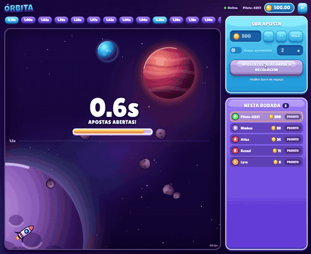

# 🚀 Órbita — Crash Game multiplayer em PixiJS

> **Projeto de estudo** para aprofundar o uso do **PixiJS 8** em um cenário real: renderização 2D em tempo real a 60 FPS, integrada a React, WebSockets e a um servidor autoritativo.

Órbita é um crash game com **moeda 100% fictícia**, sem qualquer dinheiro real envolvido. Um foguete decola, o multiplicador cresce exponencialmente e o jogador precisa **sacar antes da explosão**. O foco do projeto é técnico: como manter renderização fluida, sincronização de rede e estado de UI trabalhando juntos sem se atrapalharem.

**▶️ Jogue agora:** [orbita.vitormello.dev](https://orbita.vitormello.dev/)

<!-- Adicione aqui um GIF ou print do jogo:  -->

---

## ✨ O que este projeto demonstra

- **PixiJS 8** para toda a cena: céu estrelado com parallax, planetas e asteroides gerados proceduralmente, curva do voo, chama do foguete, partículas, explosão e onda de choque (`pixi-filters`).
- **Multiplayer em tempo real** com WebSockets (`ws`) e protocolo tipado e validado.
- **Servidor autoritativo**: o cliente só desenha; todas as decisões (aposta, saque, ponto de explosão) são do servidor.
- **Resultado verificável (commit-reveal)**: o hash da seed é publicado antes da rodada e a seed é revelada após a explosão.
- **Integração PixiJS + React** sem re-render a 60 Hz: o canvas cuida do que muda por frame, o React cuida do HUD.
- **Sincronização de relógio** cliente/servidor para uma curva suave mesmo com ticks de rede esparsos.
- **Áudio** (`@pixi/sound`): música, motor, decolagem, aposta, saque e explosão.
- **Acessibilidade e performance**: `prefers-reduced-motion`, resolução limitada em telas densas, texturas compartilhadas.
- **Monorepo TypeScript** com um pacote compartilhado entre cliente e servidor.

## 🧰 Stack

| Camada | Tecnologias |
|---|---|
| Renderização | PixiJS 8.6, pixi-filters, @pixi/sound |
| Interface | React 18, Zustand, CSS |
| Build do cliente | Vite 5, TypeScript |
| Servidor | Node.js 20+, `ws`, esbuild, tsx |
| Validação | zod (protocolo compartilhado) |
| Organização | npm workspaces (monorepo) |

## ▶️ Rodando localmente

Pré-requisito: Node.js 20 ou superior.

```bash
npm install
npm run dev
```

- Cliente: `http://localhost:5173`
- Servidor: `ws://localhost:8080` (health check em `/health`)

Para testar no celular na mesma rede, abra `http://IP-DO-PC:5173`. O cliente usa o mesmo host na porta 8080.

**Como jogar:** escolha o valor, clique em apostar na fase de apostas e saque antes do foguete explodir (botão ou barra de espaço). Também há saque automático configurável.

## 🗂️ Estrutura

```
packages/shared   Protocolo, tipos e regras da rodada (usado pelos dois lados)
server            Node + ws: máquina de estados, apostas, saques, bots
client            Vite + React + TypeScript + PixiJS 8 + Zustand
  src/net         GameSocket: reconexão e sincronização de relógio
  src/game        GameScene (renderização PixiJS) e art.ts (arte procedural)
  src/components  HUD em React (aposta, histórico, jogadores, topo, som)
  src/hooks       useLiveMultiplier
  src/audio.ts    Efeitos e música
```

## 🧠 Como renderização, input, animação e estado se conectam

1. O **servidor** roda a máquina de estados `betting → flying → crashed` e decide tudo: ponto de explosão, validação de aposta e o multiplicador no momento do saque, calculado com o relógio dele.
2. O **GameSocket** recebe os eventos e grava na store (Zustand). Ele também estima o offset entre o relógio local e o do servidor via ping/pong, usando a amostra de menor RTT.
3. A **GameScene** (PixiJS) roda no ticker próprio e lê a store com `getState()` a cada frame. Com o `startedAt` do servidor e o offset do relógio, calcula o multiplicador localmente a 60 FPS, então a curva anda suave mesmo com ticks do servidor a cada 250 ms. Os ticks servem de piso para o número nunca andar para trás.
4. O **React** só cuida do HUD. O multiplicador gigante fica dentro do canvas (`BitmapText`) para o React não re-renderizar 60 vezes por segundo. O botão de saque usa um hook a ~15 Hz, suficiente para texto.
5. O **input** (clique ou barra de espaço) vira uma mensagem para o servidor. O cliente nunca diz "saquei em 2.31x": ele diz "quero sacar" e o servidor responde com o valor real.

## 📡 Protocolo

Toda mensagem é JSON com campo `type`. As mensagens do cliente são validadas com zod no servidor (`packages/shared`).

| Direção | Tipo | Quando |
|---|---|---|
| C → S | `hello` | Ao conectar. Envia o `playerId` salvo para retomar o saldo após reconexão |
| C → S | `bet:place` | Aposta (inteiro de 1 a 500) com saque automático opcional |
| C → S | `bet:cashout` | Pedido de saque durante o voo |
| C → S | `ping` | A cada 2 s, para sincronizar o relógio |
| S → C | `welcome` | Snapshot completo: saldo, rodada atual, histórico, hora do servidor |
| S → C | `round:betting` | Nova rodada aberta, com `hash` da seed publicado antes |
| S → C | `round:flying` | Decolagem, com `startedAt` |
| S → C | `round:tick` | Multiplicador oficial a cada 250 ms |
| S → C | `round:crashed` | Ponto de explosão e `seed` revelada |
| S → C | `bet:placed` / `bet:cashedOut` | Atividade de qualquer jogador |
| S → C | `balance` | Saldo atualizado do próprio jogador |
| S → C | `error` | Código e mensagem (`ALREADY_BET`, `TOO_LATE`...) |

## 🔐 Resultado verificável (commit-reveal)

Antes da rodada, o servidor gera uma `seed` aleatória e publica apenas `sha256(seed)`. Após a explosão, revela a `seed`, e o ponto de crash é derivado dela via HMAC-SHA256 (`server/src/fairness.ts`). Qualquer pessoa pode recalcular e conferir que o resultado não foi trocado durante o voo.

## ⚙️ Decisões técnicas

- **Servidor autoritativo.** Se o cliente calculasse o saque, bastaria editar o JS para sacar sempre em 1000x.
- **Multiplicador local em vez de interpolação de ticks.** Como a curva é uma função conhecida do tempo (`exp(k·t)`), enviar só o `startedAt` e corrigir o relógio é mais preciso e mais leve do que interpolar posições.
- **Explosão no instante exato.** Além do tick de 250 ms, o servidor agenda um timer para o momento em que a curva atinge o ponto de crash. Antes de explodir, liquida todo saque automático abaixo desse ponto, mesmo que nenhum tick tenha caído entre o alvo e a explosão.
- **Efeitos presos ao ciclo da rodada.** Com a aba em segundo plano o ticker do PixiJS quase para; ao abrir uma nova rodada a cena descarta explosão, partículas e onda de choque pendentes, para nada "vazar" de uma rodada para outra.
- **Reconexão resiliente.** Backoff exponencial com jitter. O `playerId` fica no `localStorage`, então cair a internet não zera o saldo. Sem conexão, o canvas para de animar a rodada antiga e mostra o aviso até o `welcome` trazer o estado atual.
- **Performance no PixiJS.** Estrelas e partículas compartilham texturas geradas uma vez (`generateTexture`) e usam pool de sprites, em vez de um `Graphics` por objeto. O multiplicador usa `BitmapText`. Resolução limitada a 2x em telas de alta densidade.
- **Acessibilidade.** `prefers-reduced-motion` reduz partículas e desliga o tremor de tela.
- **Protocolo como contrato.** Tipos e schemas zod vivem em `packages/shared`, então cliente e servidor não divergem.

## ⚠️ Limitações conhecidas

- Estado em memória: reiniciar o servidor zera saldos e histórico.
- O servidor explode no instante exato (timer dedicado, não o tick), mas o número no cliente ainda pode passar alguns centésimos do ponto de explosão enquanto a mensagem `round:crashed` viaja pela rede; o valor oficial é sempre o do servidor.
- Os outros jogadores da lista são bots, usados para dar vida à sala.
- Sem autenticação nem persistência: o projeto é uma vitrine técnica, não um produto.

## 📊 Performance medida

_(Preencha com seus números reais.)_

- Dispositivo: ...
- FPS médio durante o voo: ...
- Print do Performance do Chrome DevTools: ...
- Lighthouse (mobile): ...

## ☁️ Deploy

**Servidor (Render ou Railway):** build `npm install && npm run build -w server`, start `npm run start -w server`. A porta vem de `PORT`.

**Cliente (Vercel):** root `client`, build `npm run build`, output `dist`, variável `VITE_WS_URL=wss://seu-servidor`.

## 🎯 O que aprendi

- Estruturar uma cena PixiJS 8 (containers, ticker, filtros, pools) e destruí-la corretamente dentro do ciclo de vida do React.
- Separar o que roda por frame (canvas) do que roda por evento (React) para manter 60 FPS.
- Projetar um protocolo em tempo real com servidor autoritativo e sincronização de relógio.
- Gerar arte e texturas proceduralmente para reduzir dependência de assets.

## 📝 Aviso

Projeto educacional. Não envolve dinheiro real, não é um produto de apostas e não deve ser usado como tal.
